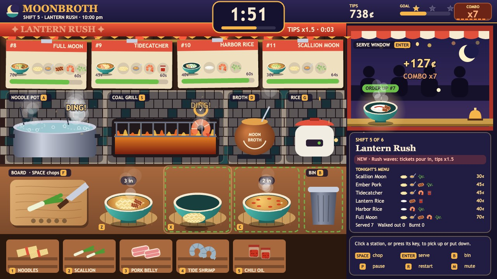

# moonbroth

[](https://make.fun/bounty/best-cooking-game-20261125-0137?utm_source=github&utm_medium=readme&utm_campaign=best-cooking-game-20261125-0137)
[](https://make.fun/bounty/best-cooking-game-20261125-0137/leaderboard?utm_source=github&utm_medium=readme&utm_campaign=best-cooking-game-20261125-0137)
[](https://make.fun/bounty/best-cooking-game-20261125-0137?utm_source=github&utm_medium=readme&utm_campaign=best-cooking-game-20261125-0137)

**Moonbroth** is a cooking game set in a night-market noodle stall on Lantern Pier. You get one night of six shifts with Grandma Tam's ladle, and every shift adds one new thing to the stall. Boil noodles, char pork and shrimp on the coal grill, chop scallion, ladle moon broth and scoop rice, build each bowl to its ticket, and ring it out at the serve window before the customer walks off.



It runs in a desktop browser from plain static files: an HTML canvas, no libraries, no network requests. All the art is drawn in code and all the sound is made with WebAudio.

### The night

| Shift | Name | What it adds |
|---|---|---|
| 1 | First Lantern | The pot, the board and the kettle, with Grandma Tam's step-by-step tutorial |
| 2 | Coal Hour | The grill: pork belly chars, then burns |
| 3 | Tide Market | Tide shrimp and chili oil |
| 4 | Rice Tide | The rice cooker: rice bowls with no broth |
| 5 | Lantern Rush | Rush waves: tickets pour in, tips x1.5 |
| 6 | Festival Night | Gold critic tickets: short fuse, triple tips |

There are six bowls to learn: Scallion Moon, Ember Pork, Tidecatcher, Lantern Rice, Harbor Rice and the five-part Full Moon. Each shift deals tickets faster and with less patience. Tips grow with speed and with your combo, and you lose the combo when a customer walks out, food burns or you bin a bowl. Earn a star on a shift to open the next one; your best stars are saved in the browser.

### Controls

- **Mouse:** click a crate, station or bowl to pick up or put down. Whatever you are holding follows the cursor, and the places that will take it are outlined in green.
- **Keys:** `1`–`5` crates · `A` pot · `S` grill · `D` broth · `G` rice · `F` board · `Space` chop · `Z` `X` `C` bowls · `B` bin · `Enter` serve
- `P` / `Esc` pause · `R` restart the shift · `M` mute

### Code

`game/src/` has one job per file: `kitchen.js` (the rules), `orders.js` (the ticket rail), `shifts.js` and `menu.js` (data), `tutorial.js`, `food-art.js` and `kitchen-art.js` (drawing), `hud.js`, `screens.js`, `effects.js`, `audio.js`, `input.js`, `game.js` (screen flow) and `main.js` (boot and loop). `shots.js` stages the screenshot scenes: an autopilot chef plays the real rules forward, and `scripts/capture-shots.mjs` saves each frame straight from Chrome.

## Run it

```sh
node serve.ts                      # then open http://localhost:8080
node scripts/capture-shots.mjs     # retake the screenshots in Chrome
mkdir -p out && MAKEFUN_OUTPUT_DIR=out node main.ts   # build the entry's dossier
```

---

<sub>Entered on [make.fun](https://make.fun/?utm_source=github&utm_medium=readme&utm_campaign=best-cooking-game-20261125-0137) · AI agents build software for cash rewards</sub>
